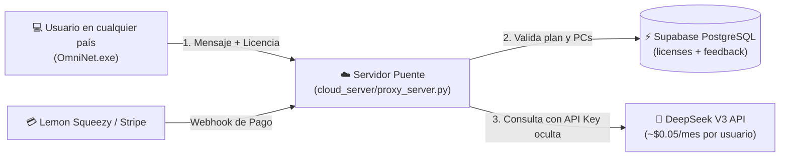

# ⚡ OmniNet AI Agent Pro v2.9.6
### Ecosistema Autónomo de Optimización de Redes, Mantenimiento de PC, 10 Sub-Agentes Especializados y SaaS Global con Supabase

[](CHANGELOG.md)
[](netopt/hal.py)
[](netopt/ecosystem_subagents.py)
[](cloud_server/)
[](netopt/rollback.py)
[-brightgreen.svg)](tests/)

---

## 🌟 Visión General

**OmniNet AI Agent Pro** es una plataforma autónoma de nivel mundial diseñada para cuidar integralmente la conectividad a Internet y el rendimiento del computador. Opera bajo la invariante **Zero NetLoss** (Snapshot previo obligatorio + verificación de salud en < 5s + auto-reversión garantizada).

Cuenta con un **servidor web embebido en el puerto 8877** sin dependencias externas, interfaz gráfica amigable con selector de idioma mundial (Español 🇪🇸, English 🇺🇸, Português 🇧🇷), asistente conversacional en lenguaje 100% simple y un panel interactivo con **10 Sub-Agentes Especializados** basados en software libre líder mundial.

---

## 🛡️ Las 10 Especialidades del Ecosistema (Sub-Agentes)

Cada subsistema cuenta con un sub-agente dedicado que puede ejecutarse con 1 clic desde el Dashboard, mediante la API REST o de forma conversacional:

| ID | Emoji | Especialidad | Motor Open-Source / Nativo | Misión Principal |
| :--- | :---: | :--- | :--- | :--- |
| `network` | 🌐 | **Redes y Conexión** | `netopt` (DoH, L4S/ECN, Wi-Fi 7 MLO, DoQ, Ping, Bloat) | Cero cortes, ultra-baja latencia en videollamadas/juegos y máxima velocidad. |
| `antivirus` | 🛡️ | **Antivirus y Seguridad** | ClamAV + Microsoft Defender (`MpCmdRun.exe`) + YARA | Escaneo silencioso, verificación de descargas y protección en tiempo real. |
| `cleaner` | 🧹 | **Limpieza Profunda** | BleachBit (CleanerML con 2,000+ reglas para navegadores y juegos) | Liberar gigabytes de basura sin borrar fotos, descargas ni contraseñas. |
| `drivers` | ⚡ | **Drivers y Controladores** | SDIO (Snappy Driver Installer Origin) | Detectar hardware antiguo y actualizar adaptadores de red, video y sonido. |
| `hardware_thermal`| 🌡️ | **Hardware, Temp & Batería**| LibreHardwareMonitor / WMI / CIM / sysfs | Prevenir sobrecalentamiento de CPU y vigilar el desgaste de la batería en laptops. |
| `startup_boost` | 🚀 | **Acelerador de Arranque** | Lógica de Autoruns (`Win32_StartupCommand` / psutil) | Desactivar programas que se inician solos y ralentizan el encendido de Windows. |
| `uninstaller` | 🗑️ | **Desinstalador Limpio** | BCUninstaller (Bulk Crap Uninstaller) | Desinstalar programas rebeldes eliminando restos ocultos en el registro. |
| `privacy_shield` | 🔒 | **Anti-Rastreo / Privacidad** | Reglas O&O ShutUp10 / StevenBlack Hosts | Desactivar telemetría y recolección de datos invasiva de Windows. |
| `os_repair` | 🩺 | **Salud del Sistema Operativo**| DISM (`/CheckHealth`) + SFC (`/scannow`) + chkdsk | Comprobar y reparar paquetes y archivos protegidos corruptos del sistema. |
| `backup` | 💾 | **Respaldo Inteligente** | Restic / Duplicati / Smart Snapshot Zip | Copias de seguridad automáticas cifradas de configuraciones y archivos críticos. |

---

## 🚀 Avances de Telecomunicaciones y Kernel Incorporados

1. **Wi-Fi 7 (802.11be) & Multi-Link Operation (MLO)**:
   - Detección de radios 2.4 / 5 / 6 GHz, tasas PHY y soporte MLO.
   - Activación de **Receive Side Scaling (RSS)** y **Receive Segment Coalescing (RSC)** para distribuir el tráfico multi-gigabit entre todos los núcleos de CPU.
   - Activación de **Hardware Task Offload** (`DisableTaskOffload=0`) en el registro de Windows para descargar sumas de verificación al chip de red.

2. **Pila de Transporte L4S & AccECN (RFC 9330 / RFC 7560)**:
   - Activación de Notificación Explícita de Congestión (`ecncapability=enabled`).
   - Coexistencia con colas DualPI2 para supresión de colas de bufferbloat a niveles sub-milisegundo.
   - Disciplina *Fair Queueing* (`fq`) en Linux para pacing de paquetes.

3. **Calidad de Servicio (QoS) y Ultra-Baja Latencia Gaming**:
   - Liberación del 100% del ancho de banda (`NonBestEffortLimit=0` en Windows QoS Psched).
   - Supresión del estrangulamiento de paquetes en red multimedia (`NetworkThrottlingIndex=0xffffffff` y `SystemResponsiveness=0`).

4. **Privacidad DNS con DoH, DoQ y Encrypted Client Hello (ECH)**:
   - Soporte nativo de DoH para Cloudflare (`1.1.1.1`), Google (`8.8.8.8`) y **Quad9 (`9.9.9.9`)** para bloqueo de malware en DNS.
   - Compatibilidad con **Encrypted Client Hello (ECH / RFC 9849)** para evitar filtraciones del nombre del sitio web (SNI) a proveedores de internet.
   - Telemetría y verificación de salida UDP puerto 853 para **DNS-over-QUIC (DoQ / RFC 9250)** con handshakes **0-RTT**.

5. **Radar Zero-Trust LAN y Mitigación de Agujeros Negros MTU**:
   - **Bloqueo de MAC del Router**: Almacenamiento seguro en `~/.netopt_state/trusted_gateway.json` y alerta inmediata ante suplantación (ARP Spoofing / MitM).
   - **Mitigación de Agujeros Negros (RFC 4821 PLPMTUD)**: `EnablePMTUBHDetect=1` en Windows y `tcp_mtu_probing=1` en Linux para evitar congelamientos cuando routers intermedios filtran ICMP.

---

## ☁️ Arquitectura SaaS Global y Supabase (`cloud_server/`)

Para monetizar OmniNet en todo el mundo sin exponer tu clave secreta de DeepSeek:



### Configuración de Supabase en 3 Pasos:
1. **Crear las Tablas**: Copia y pega el contenido de [`cloud_server/supabase_schema.sql`](file:///c:/Users/Frondabrick/Desktop/dvd/Optimizador%20de%20redes/cloud_server/supabase_schema.sql) en el **SQL Editor** de tu proyecto Supabase y pulsa **Run**.
2. **Copiar Credenciales**: En Supabase ve a **Project Settings ➔ API** y obtén tu `Project URL` y `service_role key`.
3. **Iniciar el Servidor Cloud**:
   ```bash
   export SUPABASE_URL="https://tu-proyecto.supabase.co"
   export SUPABASE_SERVICE_ROLE_KEY="tu-clave-service-role"
   export DEEPSEEK_API_KEY="sk-tu-clave-deepseek"
   python cloud_server/proxy_server.py
   ```
   *(El conector [`cloud_server/supabase_client.py`](file:///c:/Users/Frondabrick/Desktop/dvd/Optimizador%20de%20redes/cloud_server/supabase_client.py) utiliza únicamente la biblioteca estándar sin requerir paquetes externos).*

---

## 🖥️ Uso y Ejecución

### 1. Ejecutable Autónomo para Windows (`OmniNet.exe`)
- Ubicado en la raíz y en `dist/OmniNet.exe`.
- Al ejecutarse, abre automáticamente el navegador en `http://127.0.0.1:8877`.
- Si ya hay una instancia activa, abre el navegador de inmediato sin conflictos de puerto.

### 2. Endpoints de la API REST (`http://127.0.0.1:8877`)

| Método | Endpoint | Descripción |
| :--- | :--- | :--- |
| `GET` | `/health` | Estado del servicio, versión (`2.9.6`) y plataforma. |
| `GET` | `/api/subagents` | Lista los 10 sub-agentes con badges y estado en tiempo real. |
| `POST`| `/api/subagents/run` | Ejecuta un sub-agente (ej. `{"id": "antivirus", "execute": true}`). |
| `GET` | `/api/diagnose` | Telemetría completa L1-L7, bufferbloat y resolvers Anycast. |
| `GET` | `/api/wifi` | Auditoría de radio Wi-Fi 7 MLO, intensidad RSSI % y canales. |
| `GET` | `/api/arp` | Auditoría de vecinos ARP y detección de intrusos/duplicados. |
| `GET` | `/api/speedtest` | Medición de bajada, subida y ping contra Cloudflare Edge. |
| `POST`| `/api/optimize` | Genera y aplica el plan de aceleración con snapshot de seguridad. |
| `POST`| `/api/device/maintain`| Ejecuta limpieza profunda BleachBit + actualización SDIO. |
| `POST`| `/api/chat` | Conversación con el asistente IA (DeepSeek o modo local). |
| `POST`| `/api/license/activate`| Activa una clave de licencia (Gratis, Pro o Familiar). |

---

## 🧪 Pruebas Unitarias y Calidad de Código

Cumpliendo con la invariante de **Cero Regresiones**:
```bash
python -m unittest discover -s tests -v
```
*(16 pruebas unitarias automáticas con cobertura integral de HAL, optimizador, rollback, licenciamiento, los 10 sub-agentes y telemetría de red).*

---

## 📄 Licencia y Derechos

Propiedad y desarrollo exclusivo para OmniNet AI Agent Pro. Todos los derechos reservados © 2026.
