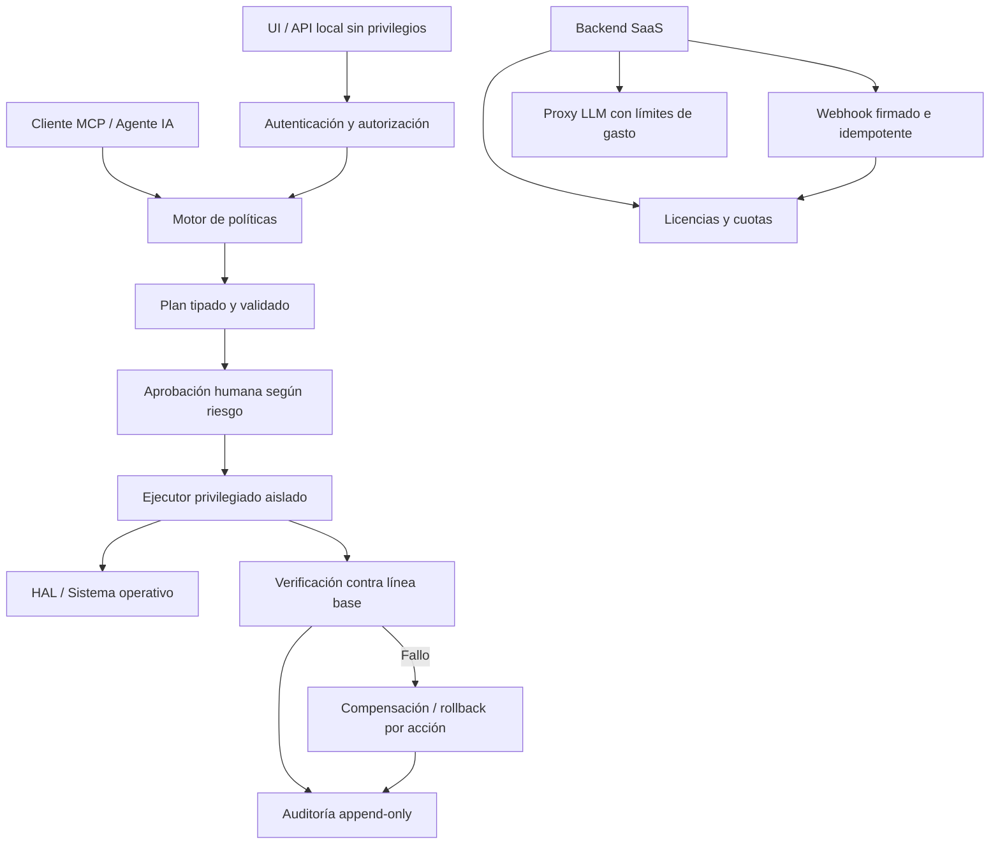

Auditoría técnica y de seguridad — OmniNetSaasia
Repositorio: https://github.com/galleguillosdavid-coder/OmniNetSaasia
Proyecto declarado: OmniNet AI Agent Pro
Versión declarada: 2.9.6
Rama revisada: main
Fecha de revisión: 2026-11-05
Tipo: revisión estática de arquitectura, código fuente y controles de seguridad
Estado: auditoría parcial del código accesible; no equivale a pentest ni a certificación de seguridad.

1. Dictamen ejecutivo
Dictamen: NO APTO PARA PRODUCCIÓN ni para instalar con privilegios administrativos en equipos que contengan información sensible, hasta corregir los hallazgos críticos y altos.

El proyecto reúne funciones útiles —diagnóstico de red, optimización de parámetros, mantenimiento del sistema, API local, MCP y backend SaaS—, pero la implementación revisada presenta fallos de diseño que contradicen varias de sus garantías declaradas.

Los problemas más importantes son:
1. El webhook de pagos permite crear licencias sin verificar la autenticidad del proveedor de pago.
2. El secreto HMAC de licencias tiene un valor predeterminado embebido en el código cliente y existen claves maestras aceptadas directamente.
3. El proxy SaaS no valida correctamente el estado de la licencia ni vincula las consultas a un dispositivo autorizado.
4. La API local escucha en todas las interfaces (0.0.0.0) y no exige autenticación para operaciones que modifican la configuración del equipo.
5. La API local permite solicitar execute=true desde una petición HTTP sin autenticación ni confirmación de privilegios.
6. La configuración LLM puede devolver el secreto api_key en una respuesta GET; el código crea una copia y agrega una versión enmascarada, pero no elimina el valor original.
7. La promesa Zero NetLoss no está demostrada: el rollback cubre solo una parte de los cambios y la verificación posterior es demasiado débil para justificar una garantía de cero pérdida de conectividad.
8. El mantenimiento del sistema realiza acciones de alto impacto (limpieza, registro, servicios, drivers, puertos y parámetros del kernel) bajo una única opción de ejecución, sin una política de aprobación granular demostrada.
No recomiendo desplegar el backend SaaS públicamente ni ejecutar mantenimiento automático con privilegios elevados antes de corregir estos puntos.
2. Alcance, método y límites
Revisado
- README.md
- main.py
- mcp_server.py
- netopt/hal.py
- netopt/rollback.py
- netopt/optimizer.py
- netopt/licensing.py
- netopt/models.py
- netopt/device_maintenance.py
- netopt/ecosystem_subagents.py
- cloud_server/proxy_server.py
- cloud_server/supabase_client.py
- cloud_server/supabase_schema.sql
- .gitignore
- Historial reciente de commits de main.
No ejecutado
- No se ejecutó python -m unittest.
- No se ejecutaron pruebas de integración ni pruebas de regresión en Windows, Linux o macOS.
- No se realizó fuzzing HTTP/MCP.
- No se desplegó el backend ni se probaron credenciales reales de Supabase/DeepSeek.
- No se inspeccionó el comportamiento de un ejecutable compilado.
- No se verificó el contenido completo de todos los archivos ni todos los flujos del repositorio.
Por lo tanto, las observaciones de código que se describen a continuación son hallazgos estáticos reproducibles en los archivos indicados. Los resultados de ejecución, compatibilidad real y exposición externa quedan pendientes de validación dinámica.
3. Hallazgos priorizados
ID	Severidad	Área	Hallazgo	Estado
OMNI-001	CRÍTICA	SaaS / pagos	Webhook de pagos sin validación criptográfica de firma	Confirmado en código
OMNI-002	CRÍTICA	Licenciamiento	Secreto HMAC predeterminado y claves maestras codificadas	Confirmado en código
OMNI-003	CRÍTICA	API local	API sin autenticación, expuesta en 0.0.0.0, con operaciones de modificación	Confirmado en código
OMNI-004	ALTA	Proxy SaaS	/v1/chat no comprueba estado activo ni vinculación del dispositivo	Confirmado en código
OMNI-005	ALTA	Privacidad	La API de configuración LLM puede devolver el secreto completo	Confirmado en código
OMNI-006	ALTA	Seguridad operativa	Rollback incompleto frente a las acciones de mantenimiento	Confirmado en código
OMNI-007	ALTA	Seguridad operativa	Verificación Zero NetLoss insuficiente para la garantía declarada	Confirmado en código
OMNI-008	ALTA	SaaS / privacidad	El backend guarda mensajes y claves de licencia en feedback sin anonimización real	Confirmado en código
OMNI-009	MEDIA	API / disponibilidad	Sin límites visibles de tamaño de petición, tasa o concurrencia	Confirmado en código revisado
OMNI-010	MEDIA	Red / HAL	Comandos y parámetros no están sujetos a una validación central estricta	Confirmado en código
OMNI-011	MEDIA	Compatibilidad	Implementaciones multiplataforma contienen rutas de fallback que reportan datos ficticios o no equivalentes	Confirmado en código
OMNI-012	MEDIA	Calidad / evidencia	Las afirmaciones del README y los resultados de pruebas no quedan demostrados por la evidencia examinada	Pendiente de CI y ejecución

4. Análisis técnico de los hallazgos
OMNI-001 — CRÍTICA: webhook de pagos falsificable
Archivo: cloud_server/proxy_server.py
Zona: do_POST, rama /v1/webhooks/payment.

El endpoint recibe datos JSON, toma un correo y un plan, genera una licencia y la guarda. En el flujo revisado no se valida:
- Firma HMAC del webhook.
- Secreto compartido del proveedor.
- Identificador del evento contra la API del proveedor.
- Estado efectivo del pago.
- Importe, moneda, producto o suscripción.
- Idempotencia del evento.
Cualquier cliente que alcance este endpoint podría enviar un POST con un correo y un plan pro o family y obtener una licencia generada por el servidor.

Impacto: emisión fraudulenta de licencias y pérdida directa de ingresos. También se contamina el registro de eventos de pago.

Corrección obligatoria:
1. Implementar validación de firma según la documentación oficial del proveedor.
2. Rechazar solicitudes sin firma válida antes de procesar el JSON.
3. Verificar el evento y su estado con el proveedor cuando corresponda.
4. Registrar el ID único del evento y aplicar idempotencia.
5. No generar licencias a partir de campos libres enviados por el cliente.
6. Separar adaptadores de Stripe y Lemon Squeezy; no tratar sus payloads como equivalentes.
Prueba de aceptación: un POST sin firma, con firma inválida o con evento duplicado no debe emitir una licencia ni alterar la base de datos.
OMNI-002 — CRÍTICA: secreto de firma de licencias comprometible
Archivo: netopt/licensing.py
Zona: constante SIGNING_SECRET y funciones generate_signed_license_key() / verify_signed_license_key().

El secreto usa un valor predeterminado fijo:
SIGNING_SECRET = os.environ.get(
    "OMNINET_LICENSE_SECRET",
    "omninet-global-saas-hmac-2026-secret"
)
El mismo módulo también reconoce claves maestras estáticas como OMNI-PRO-MASTER-2026, OMNI-PRO-DEMO-2026 y ADMIN-PRO.

El cliente necesita verificar licencias localmente y contiene la lógica y el secreto por defecto. Un secreto incluido en una aplicación distribuida no puede considerarse secreto: puede extraerse del código o del ejecutable.

Además, la firma usa solo los primeros cuatro caracteres hexadecimales del HMAC, es decir, 16 bits de salida. Esto es insuficiente como autenticador criptográfico para un sistema de licencias expuesto a intentos de falsificación.

Impacto: falsificación de licencias, desbloqueo no autorizado de planes y pérdida de control sobre la monetización.

Corrección obligatoria:
- Eliminar secretos predeterminados y claves maestras universales.
- No distribuir una clave HMAC compartida dentro del cliente.
- Usar licencias firmadas asimétricamente: la clave privada permanece solo en el backend y el cliente verifica con una clave pública.
- Usar una firma estándar con longitud completa, por ejemplo Ed25519, mediante una biblioteca mantenida.
- Incorporar expiración, producto, plan, identificador de licencia, versión de esquema y restricciones necesarias en el contenido firmado.
- Rotar cualquier secreto que haya sido usado en versiones distribuidas.
Prueba de aceptación: una instalación cliente no debe poder emitir licencias válidas; solo el servicio emisor autorizado debe poder firmarlas.
OMNI-003 — CRÍTICA: API local sin autenticación y accesible desde la red
Archivo: main.py
Zonas: send_json(), do_POST() y start_api_server().

La API responde con:
self.send_header("Access-Control-Allow-Origin", "*")
Y el servidor se crea con:
ThreadingHTTPServer(("0.0.0.0", port), OmniNetAPIHandler)
El servidor queda escuchando en todas las interfaces de red, no solo en loopback. En do_POST() se acepta un campo controlado por el solicitante:
execute = bool(payload.get("execute", False))
Ese valor se propaga a operaciones como optimización, reparación, rollback y mantenimiento. No se observa una comprobación de autenticación/autorización antes de ejecutar estas ramas.

Impacto: otro equipo de la LAN —o un origen remoto si existe exposición adicional— podría intentar activar operaciones de modificación del sistema. El riesgo aumenta si OmniNet se ejecuta como administrador.

CORS no es autenticación. Cambiar el encabezado CORS por sí solo tampoco corrige el problema: clientes no navegador pueden llamar directamente a la API.

Corrección obligatoria:
1. En modo local, enlazar por defecto a 127.0.0.1.
2. Si se requiere acceso LAN, exigir autenticación fuerte y TLS mediante un diseño explícito.
3. Exigir token de sesión aleatorio, no predecible y protegido contra CSRF cuando corresponda.
4. Separar endpoints de lectura de endpoints que modifican el sistema.
5. Exigir autorización por acción y confirmación explícita.
6. No aceptar execute=true como única condición para realizar cambios.
7. Añadir límites de tasa, tamaño de cuerpo y tiempo de petición.
8. No devolver información administrativa a usuarios no autenticados.
Prueba de aceptación: una petición sin credenciales debe recibir 401 o 403; un proceso remoto de la LAN no debe poder ejecutar una optimización o mantenimiento.
OMNI-004 — ALTA: el proxy no valida correctamente la licencia ni el dispositivo
Archivo: cloud_server/proxy_server.py
Zona: endpoint /v1/chat.

El código obtiene la licencia y, si no encuentra un registro, acepta que la firma local sea válida:
plan_sig = verify_signed_license_key(key)
if not rec and not plan_sig:
    ...
No se exige que el registro exista y esté activo en todos los casos. Tampoco se comprueba que device_id pertenezca a la lista de dispositivos autorizados antes de procesar el chat. El límite de dispositivos se comprueba en activación, pero no se vuelve a aplicar en el endpoint de consumo.

El contador de consultas aumenta, pero no se aplica el límite mensual declarado en PLAN_CATALOG.

Impacto: uso del proxy con claves firmadas sin registro activo, evasión de restricciones por dispositivo y consumo de API sin aplicación efectiva de cuotas.

Corrección obligatoria:
- Exigir registro existente, activo y no expirado.
- Comprobar el dispositivo registrado en cada solicitud.
- Aplicar cuotas y límites de velocidad en el servidor.
- No confiar en un device_id enviado libremente por el cliente; usar una credencial de dispositivo o sesión vinculada criptográficamente.
- Revocar sesiones al cancelar o expirar una suscripción.
- Aplicar límites de tokens, tamaño de mensajes y gasto por cuenta.
OMNI-005 — ALTA: exposición de API key LLM
Archivo: main.py
Zona: GET /api/llm/config.

El código hace una copia de la configuración y agrega un campo enmascarado:
safe_cfg = cfg.copy()
if safe_cfg.get("api_key"):
    safe_cfg["api_key_masked"] = (
        safe_cfg["api_key"][:4] + "..." + safe_cfg["api_key"][-3:]
    )
self.send_json(200, safe_cfg)
Pero el campo original api_key sigue presente en safe_cfg. Por tanto, la respuesta puede contener el secreto completo además de la versión enmascarada.

El POST /api/llm/config también devuelve gateway.config en la respuesta, por lo que debe revisarse para evitar que una actualización exponga el secreto.

Impacto: exposición de credenciales de proveedores LLM a cualquier cliente que pueda acceder a la API local.

Corrección obligatoria:
- Construir una respuesta por lista permitida de campos.
- Nunca serializar api_key, tokens OAuth, secretos ni credenciales.
- Separar lectura de configuración y actualización de secretos.
- Mostrar solo un booleano api_key_configured y, si es necesario, un indicador parcial no reversible.
- Exigir autenticación en el endpoint.
Prueba de aceptación: búsquedas automatizadas en las respuestas GET y POST no deben encontrar el valor real de una clave configurada.
OMNI-006 — ALTA: rollback no restaura el conjunto completo de cambios
Archivos: netopt/rollback.py, netopt/optimizer.py, netopt/device_maintenance.py.

El snapshot guarda DNS, parámetros TCP y MTU. El mantenimiento, en cambio, puede modificar también:
- Registro de Windows.
- Servicios del sistema.
- Configuración de energía de NIC.
- Cachés y archivos temporales.
- Rango de puertos efímeros.
- Configuración de kernel/sysctl.
- Drivers y software de terceros.
- Procesos y tareas de mantenimiento.
El rollback mostrado restaura TCP, DNS, MTU y caché DNS. No restaura drivers, registro, servicios, archivos borrados, procesos terminados ni todos los parámetros alterados por mantenimiento.

En run_full_device_maintenance(), el snapshot se captura, se ejecutan muchas operaciones y luego se verifica la conectividad. Si la verificación falla, se llama al rollback de red, pero eso no revierte todas las acciones del mantenimiento.

Impacto: el nombre “rollback” y la garantía de recuperación exceden lo que realmente implementa el código.

Corrección obligatoria:
- Definir un inventario explícito de cada tipo de cambio.
- Asociar a cada acción una función compensatoria verificable.
- Para cambios no reversibles (eliminación de archivos, actualización de drivers), crear respaldo o excluirlos del modo automático.
- Registrar estado anterior, estado posterior, resultado y compensación por acción.
- Si una acción no tiene reversión demostrable, exigir aprobación individual.
- Diferenciar network_rollback de full_system_restore; no afirmar que son equivalentes.
OMNI-007 — ALTA: Zero NetLoss no está demostrado por el verificador
Archivo: netopt/rollback.py
Zona: verify_post_action_health().

El verificador:
- Mide solo 1.1.1.1 inicialmente.
- Usa tres muestras.
- Considera pérdida grave a partir de 66%.
- Consulta 8.8.8.8 solo si la pérdida del primer destino alcanza ese umbral.
- Considera saludable una latencia media de hasta 500 ms.
- No compara las métricas con una línea base previa.
- No comprueba DNS real, gateway, rutas, interfaces, sesiones activas ni conectividad de aplicaciones.
- No verifica que cada comando aplicado haya tenido éxito.
Con esos umbrales, degradaciones importantes pueden pasar como saludables. Por ejemplo, una pérdida de paquetes inferior al umbral no activa necesariamente la reversión. Tampoco se demuestra que el equipo conserve la conectividad que tenía antes de optimizar.

Impacto: la afirmación “Zero NetLoss” no está respaldada por el mecanismo de verificación mostrado.

Corrección obligatoria:
1. Tomar línea base antes de cada cambio.
2. Verificar gateway, DNS, varios destinos y conectividad TCP/HTTPS.
3. Comparar pérdida, RTT y resolución DNS contra la línea base.
4. Verificar cada resultado de comando y detener el plan ante errores.
5. Hacer pruebas repetidas durante una ventana temporal.
6. Definir umbrales configurables y justificados.
7. Ejecutar rollback ante degradación significativa y verificar también el resultado del rollback.
8. Reportar PASS, FAIL o INCONCLUSIVE; nunca convertir falta de evidencia en éxito.
OMNI-008 — ALTA: tratamiento de datos conversacionales no es anónimo
Archivo: cloud_server/proxy_server.py y cloud_server/supabase_client.py.

El proxy guarda device_id, license_key y parte del último mensaje del usuario en archivos locales y en Supabase. El código lo denomina feedback anónimo, pero esos campos permiten vincular registros a una licencia y dispositivo.

No se observa en el flujo revisado:
- Consentimiento explícito para almacenar contenido.
- Política de retención configurable.
- Minimización o anonimización irreversible.
- Mecanismo de borrado por usuario.
- Separación entre telemetría operacional y contenido conversacional.
Impacto: riesgo de privacidad, exposición de conversaciones y acumulación de datos personales o sensibles.

Corrección obligatoria:
- Desactivar por defecto el almacenamiento del contenido conversacional.
- Solicitar consentimiento informado y separado.
- Guardar métricas agregadas cuando sea suficiente.
- Eliminar claves de licencia y device IDs de los eventos de feedback.
- Definir retención, borrado, control de acceso y cifrado.
- Publicar una política de privacidad coherente con el comportamiento real.
OMNI-009 — MEDIA: controles insuficientes de disponibilidad en HTTP
Archivos: main.py, cloud_server/proxy_server.py.

En el código revisado se usa ThreadingHTTPServer, se lee Content-Length y se procesa el cuerpo sin que se observe un límite máximo central. Tampoco se aprecia limitación de tasa o concurrencia.

El backend SaaS permite operaciones costosas y llamadas a un proveedor externo. El endpoint de chat puede almacenar feedback y consumir DeepSeek.

Impacto: solicitudes enormes, ráfagas o concurrencia elevada pueden consumir memoria, hilos, disco o presupuesto de API.

Corrección:
- Establecer límite estricto de cuerpo HTTP.
- Validar Content-Type y JSON.
- Limitar conexiones concurrentes y tasa por IP/licencia.
- Definir timeout de lectura y escritura.
- Aplicar presupuesto máximo diario/mensual al proveedor LLM.
- Usar un servidor WSGI/ASGI de producción detrás de un reverse proxy mantenido, con TLS.
OMNI-010 — MEDIA: validación central de comandos y parámetros insuficiente
Archivo: netopt/hal.py.

run_cmd() ejecuta comandos del sistema. Aunque muchos comandos se construyen como listas, también admite cadenas y shell=True. Hay interpolación de valores en comandos PowerShell y shell, por ejemplo nombres de interfaces y listas DNS.

El diseño no muestra una capa única de validación que limite los parámetros aceptables por operación.

Impacto: errores de quoting, inyección de comandos si valores externos alcanzan esos parámetros, o cambios fuera de la intención del usuario.

Corrección:
- Evitar shell=True siempre que exista alternativa.
- Validar interfaces contra inventario local obtenido por el sistema.
- Validar direcciones IP con parsers estándar.
- Usar listas permitidas para parámetros TCP/sysctl.
- No aceptar comandos arbitrarios desde el LLM, MCP o API.
- Ejecutar con privilegios mínimos y separar procesos privilegiados de la interfaz.
OMNI-011 — MEDIA: resultados de diagnóstico pueden ser engañosos
Archivo: netopt/hal.py.

En el fallback de WindowsHAL.get_interfaces(), ante una excepción se agrega una interfaz ficticia DefaultInterface con 127.0.0.1 y is_up=True. En get_dns_servers() también se devuelven resolvers públicos por defecto cuando falla la lectura del sistema.

Estos valores no representan necesariamente la configuración real del equipo.

Además, en enable_encrypted_dns_doh(), la rama Linux ejecuta resolvectl dnsovertls yes, que no equivale a configurar de forma universal DoH. La rama para otros sistemas puede limitarse a vaciar caché DNS aunque la descripción de la acción diga que habilita DNS cifrado.

Impacto: falsos positivos, diagnósticos incompletos y reportes que presentan una operación como exitosa sin demostrar que el sistema la realizó.

Corrección:
- Representar fallos de detección como UNKNOWN o error, nunca como datos reales ficticios.
- Diferenciar DoH, DoT y DoQ en código, interfaz y telemetría.
- Detectar capacidades del sistema antes de proponer comandos.
- Verificar el estado real después de ejecutar cada operación.
- No declarar “habilitado” solo porque el proceso terminó sin excepción.
OMNI-012 — MEDIA: afirmaciones del README no equivalen a evidencia
Archivo: README.md.

El README declara, entre otros puntos:
- 16/16 pruebas aprobadas.
- Zero NetLoss.
- Auto-rollback garantizado.
- Compatibilidad Windows/Linux/macOS.
- 10 subagentes especializados.
- Tecnologías como Wi-Fi 7 MLO, L4S/ECN, DoQ y ECH.
La revisión estática encontró diferencias entre varias descripciones y el alcance real de las funciones examinadas. Por ejemplo, el rollback no cubre todas las acciones del mantenimiento y los fallbacks DNS no prueban que DoH/DoT/DoQ estén activos.

No se pudo reproducir el resultado 16/16 porque esta auditoría no ejecutó la suite en un entorno controlado. Tampoco se considera prueba suficiente un badge o una afirmación textual.

Corrección:
- Adjuntar resultados de CI con versión de Python, SO y dependencias.
- Publicar comandos reproducibles y logs.
- Separar pruebas unitarias, integración, hardware real y pruebas de seguridad.
- Cambiar las afirmaciones no demostradas por lenguaje de capacidad o estado experimental.
- Mantener una matriz de compatibilidad por sistema operativo y versión.
5. Problemas de arquitectura
5.1 Mezcla de planos de control y ejecución
El mismo proceso expone interfaz web, API REST, ejecución de comandos, mantenimiento y tareas autónomas. Esto amplía el impacto de cualquier vulnerabilidad web.

Recomendación: dividir en:
- UI/API sin privilegios.
- Servicio privilegiado local con protocolo IPC autenticado.
- Motor de políticas que aprueba acciones.
- Ejecutor aislado que solo acepta operaciones tipadas.
- Auditoría append-only de decisiones y resultados.
El modelo LLM y los subagentes deben proponer acciones, no tener autoridad directa para ejecutarlas.
5.2 Falta de una política de autorización por acción
Un booleano execute es demasiado grueso para operaciones heterogéneas. Cambiar DNS no tiene el mismo riesgo que borrar archivos, modificar registro, actualizar drivers o reiniciar servicios.

Recomendación: cada acción debe declarar:
- Identificador y versión.
- Objetivo exacto.
- Parámetros validados.
- Riesgo.
- Privilegios requeridos.
- Precondiciones.
- Evidencia previa.
- Aprobación necesaria.
- Método de reversión.
- Prueba posterior.
- Resultado y trazabilidad.
5.3 MCP: autoridad del cliente y validación
mcp_server.py permite que una llamada de herramienta suministre execute; además, network_discover_and_schedule_tasks usa por defecto execute=True si el argumento no está presente.

Esto es especialmente peligroso en herramientas conectadas a un agente que puede decidir cuándo invocarlas.

Recomendación: el valor predeterminado de todas las herramientas debe ser no destructivo. Las operaciones de escritura deben requerir una aprobación externa verificable, no una instrucción generada por el propio modelo. El servidor MCP debe validar esquema, rangos, permisos y límites independientemente del cliente.
6. Correcciones por prioridad
P0 — Bloqueantes antes de cualquier despliegue
- [ ] Cerrar o proteger el webhook de pagos con firma oficial e idempotencia.
- [ ] Eliminar el secreto HMAC predeterminado y las claves maestras universales.
- [ ] Migrar a licencias firmadas asimétricamente.
- [ ] Proteger la API local con autenticación y enlazar a loopback por defecto.
- [ ] Impedir operaciones privilegiadas mediante una simple bandera execute=true.
- [ ] Corregir la exposición de api_key en las respuestas LLM.
- [ ] Deshabilitar el endpoint de administración SaaS hasta añadir autorización.
P1 — Antes de habilitar automatización
- [ ] Rediseñar snapshots y rollback con cobertura real por acción.
- [ ] Sustituir la verificación de salud por una comparación contra línea base.
- [ ] Validar licencia activa, expiración, dispositivo y cuotas en cada llamada al proxy.
- [ ] Separar acciones reversibles e irreversibles.
- [ ] Añadir límites HTTP, rate limiting y protección de presupuesto LLM.
- [ ] Corregir los falsos positivos de detección multiplataforma.
- [ ] Definir consentimiento, minimización y retención de datos.
P2 — Calidad y mantenibilidad
- [ ] Crear matriz de capacidades reales por SO.
- [ ] Añadir pruebas de integración con mocks de comandos y pruebas en máquinas virtuales.
- [ ] Añadir pruebas negativas de autorización y validación de entradas.
- [ ] Añadir análisis estático, type checking y escaneo de dependencias.
- [ ] Publicar SBOM y fijar versiones de dependencias.
- [ ] Versionar manifiestos MCP y esquemas API.
- [ ] Mantener changelog vinculado a cambios verificables.
7. Plan de pruebas de aceptación
No declarar el proyecto corregido hasta que estas pruebas se ejecuten y se conserven sus resultados.
ID	Prueba	Resultado exigido
T-01	POST al webhook sin firma	Rechazado; cero licencias creadas
T-02	Webhook con firma inválida	Rechazado
T-03	Repetición de evento válido	Idempotente; no duplica licencia
T-04	Cliente intenta firmar licencia localmente	Imposible sin clave privada
T-05	/api/optimize sin autenticación	401/403; no modifica el host
T-06	Petición desde otro equipo de LAN	No puede ejecutar acciones
T-07	GET /api/llm/config	No contiene secretos
T-08	Chat con licencia revocada	Rechazado
T-09	Chat desde dispositivo no registrado	Rechazado
T-10	Cuota mensual excedida	Rechazado antes de llamar al proveedor
T-11	Pérdida de conectividad inducida en VM	Rollback y verificación posterior correctos
T-12	Error en una acción de mantenimiento	Detiene el plan o ejecuta compensación documentada
T-13	Parámetros malformados en API/MCP	Rechazados sin ejecutar comandos
T-14	Cuerpo HTTP excesivo	Rechazado sin agotar memoria/hilos
T-15	Diagnóstico sin permisos o herramientas	Estado UNKNOWN, no resultado ficticio
T-16	Instalación limpia por SO	Pruebas reproducibles y matriz de capacidades

Las pruebas T-11 y T-12 deben realizarse en máquinas virtuales desechables o hardware de laboratorio, nunca en el equipo de trabajo principal.
8. Diseño objetivo recomendado

Principio central: el LLM puede diagnosticar y proponer; una política determinista autoriza; un ejecutor limitado aplica; un verificador independiente comprueba.
9. Evaluación de las afirmaciones principales
Afirmación del proyecto	Evaluación de auditoría
Zero NetLoss	No demostrado. El verificador y el rollback no cubren todos los cambios ni comparan suficientemente contra la línea base.
Auto-rollback garantizado	No demostrado. Hay rutas de reversión parcial; algunas acciones no tienen compensación.
16/16 pruebas PASS	No verificado. Requiere ejecución reproducible y logs de CI.
SaaS seguro con Supabase	No apto actualmente. Webhook falsificable, licencia débil y controles de acceso incompletos.
10 subagentes especializados	Parcial. Existe un catálogo/orquestador, pero el nombre o descripción de un motor no demuestra integración funcional completa.
Compatibilidad multiplataforma	Parcial/no demostrada. Hay fallbacks no equivalentes y operaciones específicas de cada SO.
DoH / DoQ / ECH / L4S / Wi-Fi 7	Requiere pruebas de capacidad y estado real. La presencia de comandos o nombres de protocolos no demuestra negociación ni funcionamiento efectivo.

10. Conclusión final
OmniNet tiene una idea de producto ambiciosa y una estructura funcional que puede servir como prototipo. Sin embargo, el nivel de seguridad actual no corresponde a un optimizador autónomo de sistemas que puede ejecutar cambios privilegiados ni a un SaaS comercial que procesa pagos y licencias.

La prioridad no debería ser agregar más protocolos, subagentes o automatizaciones. Debería ser cerrar el perímetro de ejecución, corregir el modelo de licencias, asegurar el webhook, separar privilegios y demostrar que cada cambio es reversible o está protegido por una aprobación explícita.
Decisión de auditoría
NO APTO PARA PRODUCCIÓN.

Condiciones mínimas para reconsiderar:
1. Resolver todos los hallazgos P0.
2. Resolver los hallazgos P1 que afectan ejecución privilegiada y recuperación.
3. Ejecutar la matriz de pruebas de aceptación en entornos controlados.
4. Entregar evidencia reproducible de CI, pruebas de seguridad y pruebas de rollback.
5. Realizar una segunda auditoría independiente sobre el commit corregido.
11. Referencias del código revisado
- README.md
- main.py
- mcp_server.py
- netopt/hal.py
- netopt/rollback.py
- netopt/optimizer.py
- netopt/licensing.py
- netopt/device_maintenance.py
- netopt/ecosystem_subagents.py
- cloud_server/proxy_server.py
- cloud_server/supabase_client.py
- cloud_server/supabase_schema.sql
Nota de trazabilidad: la revisión se realizó sobre la rama main consultada el 2026-11-05. Antes de aplicar correcciones, registrar el SHA exacto del commit auditado y repetir el análisis sobre ese mismo commit. Esta auditoría no afirma que el repositorio haya sido modificado ni que los hallazgos hayan sido explotados.